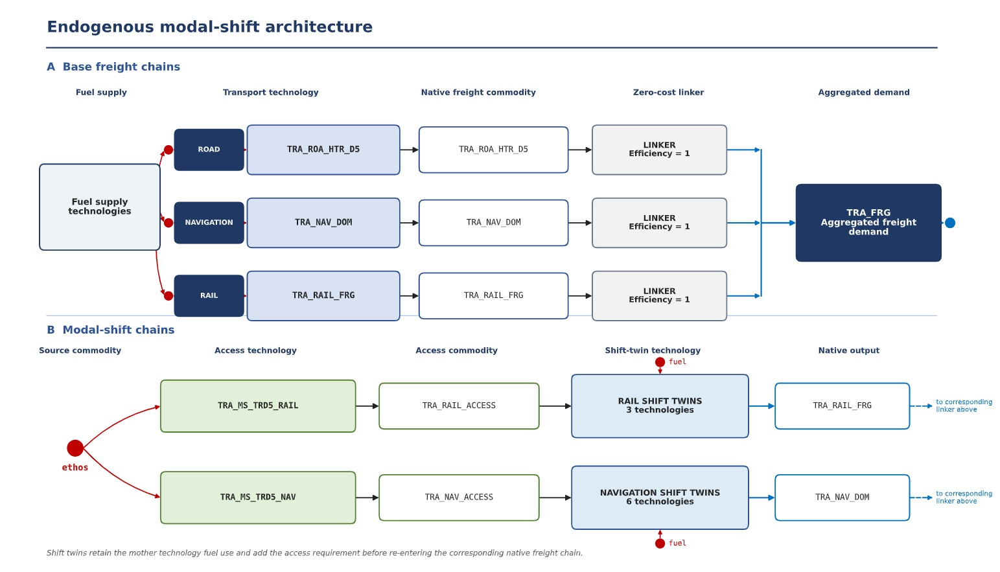

# Endogenous freight modal shift in TEMOA-Italy

An extension of [TEMOA-Italy](https://github.com/MAHTEP/TEMOA-Italy), the open energy system
optimization model of Italy, that lets long-haul road freight move to rail and coastal shipping
inside the optimization. In the original model road, rail and navigation freight are three
separate exogenous demands, so no substitution between modes is possible.

The extension is about 7,700 lines of SQL, published here as a patch on top of the public model
rather than as a full copy of it. It was developed by Filippo Cinquini and Cristiano Chiapparoli
for the course *Models and Scenarios for Energy Planning* (Politecnico di Torino, MAHTEP Group,
academic year 2025/2026).



## What the extension adds

**Part A, distance classes.** Every road-freight technology (heavy trucks HTR, medium trucks MTR,
light commercial vehicles LCV) is split into five haul-length classes, each with its own activity,
load factor, efficiency and costs.

| Class | D1 | D2 | D3 | D4 | D5 |
|---|---|---|---|---|---|
| Haul length | < 50 km | 51–150 km | 151–300 km | 301–500 km | > 500 km |

**Part B, modal shift on the D5 market.**

- *One aggregated demand.* Heavy trucks D5, rail freight and domestic navigation serve a single
  commodity `TRA_FRG` in Gtkm. The three modes are made comparable through load factors of about
  16.6 t per truck, 393 t per train and 2,119 t per vessel.
- *Linkers.* Three zero-cost technologies with efficiency 1 connect the native output of each mode
  to `TRA_FRG`, so the modes themselves are not modified.
- *Terminals.* `TRA_MS_TRD5_RAIL` and `TRA_MS_TRD5_NAV` produce the access commodities that shifted
  freight needs. They carry the intermodal infrastructure cost and a penalty for detours and
  handling (efficiency 0.87 for rail, 0.78 for sea).
- *Shift-twins.* Copies of the rail and navigation technologies that consume both the fuel of the
  original technology and the access commodity. A twin uses exactly the same energy per Gtkm as
  the original, plus the terminal chain.
- *Disjoint groups.* Existing traffic is frozen at its business-as-usual level; shifted traffic is
  capped by the EU target minus that level. The shift is an option for the solver, not an
  obligation.

The full description is in the [report](docs/report.pdf), sections 2.1 and 2.2.

## Repository layout

| Folder | Content |
|---|---|
| [`model/`](model/) | The patch: SQL additions, edits to the base model, build script, [scenario recipes](model/SCENARIOS.md) |
| [`scripts/`](scripts/) | Database creation and post-processing scripts, unit-conversion scripts, Monte Carlo |
| [`data/`](data/) | Source statistics and the workbooks used to derive the parameters, with [sources](data/SOURCES.md) |
| [`results/`](results/) | Post-processed results of the runs discussed in the report |
| [`docs/`](docs/) | Report, architecture figure, scenario tree |

## Quick start

1. Build the scenario file from the public model, release 3.3:

   ```sh
   git clone --branch 3.3 --depth 1 https://github.com/MAHTEP/TEMOA-Italy.git
   python model/build_scenario.py TEMOA-Italy/TEMOA-Italy/TEMOA_Italy.sql -o TRA_MS_ON_BAU_0.sql
   ```

2. Create the database. Copy `TRA_MS_ON_BAU_0.sql` and the files in `scripts/temoa_italy/` into the
   `data_files` folder of [MAHTEP TEMOA](https://github.com/MAHTEP/TEMOA), then run

   ```sh
   python database_creator.py
   python database_check.py
   ```

   This step needs `pandas` and takes a few minutes. All consistency checks return empty lists.

3. Solve `TRA_MS_ON_BAU_0.sqlite` with TEMOA as any other TEMOA-Italy database, then run
   `database_postprocessing.py` to export the freight technologies to Excel.

To obtain the other scenarios, apply the edits in [`model/SCENARIOS.md`](model/SCENARIOS.md) to
`TRA_MS_ON_BAU_0.sql` before step 2.

## Main findings of the report

These come from the runs described in the report (see the note below).

- **Rail shift is a no-regret measure.** It reaches the EU ceiling in every free run with no
  incentive: the binding constraint is infrastructure, not cost.
- **Maritime shift cannot be bought with vessel-side incentives.** The competitive gap (668 M€
  discounted in business as usual, 3,112 M€ under net zero) is larger than the whole subsidizable
  chain cost (385 and 546 M€), because the barrier is the marine-fuel supply chain.
- **A mandate has a measurable price**: 5.32 M€ per Gtkm·yr in business as usual and 14.95 under
  net zero.
- **Without clean marine fuels the mandate increases emissions**, since vessels burning heavy fuel
  oil displace the cleanest trucks.
- **The allocation is robust**: a Monte Carlo on terminal costs (σ = 50 %) leaves it unchanged in
  every draw.

## Status and limitations

- The published patch includes four small corrections made after the report, listed in
  [`model/README.md`](model/README.md). The corrected database builds and passes the consistency
  checks, but the scenarios have not been solved again, so the files in `results/` and the numbers
  above refer to the version before the corrections.
- Scenarios are examples of use. The contribution is the structure.
- All D5 tonne-kilometres are treated as perfectly substitutable between modes, so the shift
  potential is an upper bound.
- Intermodality penalties and terminal costs are point estimates by the authors.
- The EU ceiling is applied to the D5 band only.
- N₂O slip from ammonia-fuelled ships is not modelled. The dual-fuel shift-twin is written but
  disabled, because the additive input split cannot fix both the fuel ratio and the access ratio.

Further limitations are discussed in section 5 of the report.

## Licence

SQL, data workbooks and documentation: [CC BY 4.0](https://creativecommons.org/licenses/by/4.0/).
Code: MIT. The report in `docs/report.pdf` is © the authors. See [`LICENSE`](LICENSE).

TEMOA-Italy is © Politecnico di Torino, MAHTEP Group and contributors, released under CC BY 4.0
(database) and MIT (code). The source statistics in `data/raw/` remain subject to the terms of
Eurostat, the Joint Research Centre and ISTAT.

## Authors and acknowledgements

Filippo Cinquini and Cristiano Chiapparoli.

The work was supervised by Prof. Laura Savoldi and Dr. Matteo Nicoli (MAHTEP Group, Department of
Energy, Politecnico di Torino), who develop and maintain TEMOA-Italy.

To cite this work see [`CITATION.cff`](CITATION.cff). Please also cite TEMOA-Italy as indicated
in its repository.
